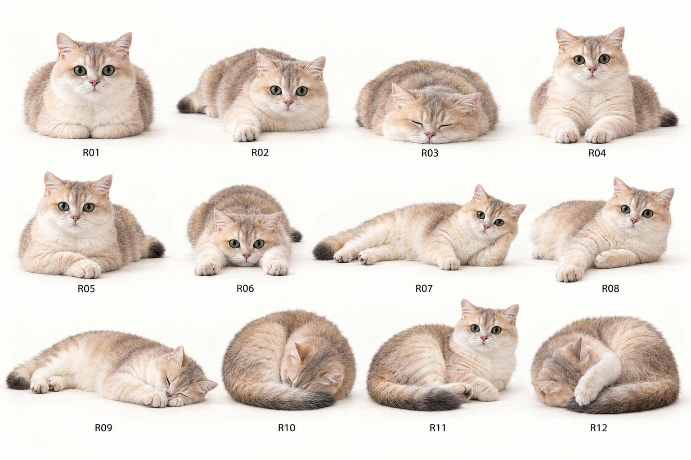
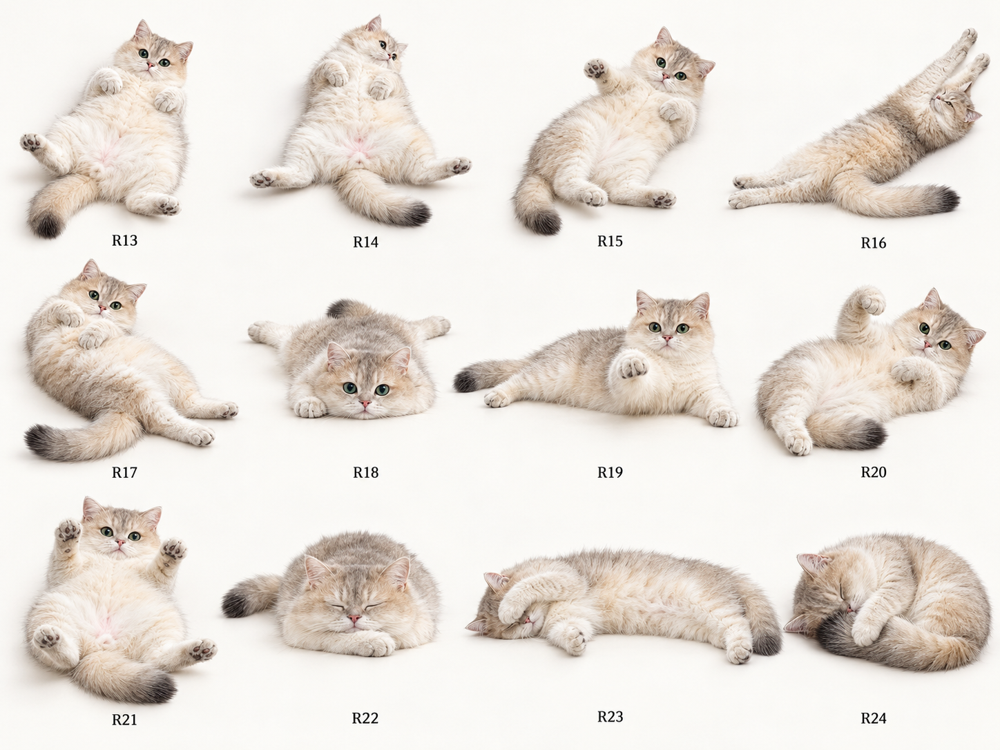
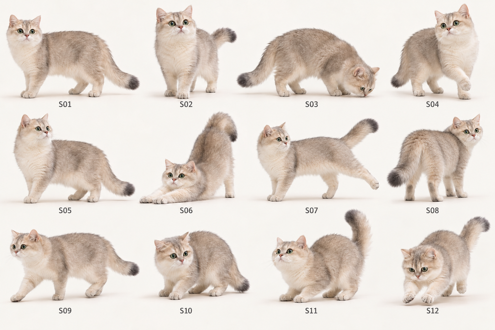
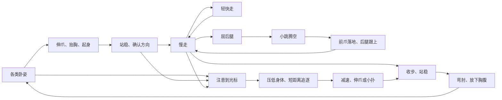

# 小家伙 V0.2：会散步、偶尔起玩心的小猫

设计日期：2026-10-30。状态：**版本设计与姿势概念，尚未实现为 V0.2 安装包**。主人已反馈 V0.1 运行成功。本目录给出下一版的行为、照片依据、36 个姿势和动画验收标准。

## 这一版的体验

小家伙趴一会儿，慢悠悠站起来，在桌面走一小段。走到一半停下看看，偶尔轻轻蹦两下，再找个位置换一种姿势趴好。有时她会突然想起光标：先看一眼，压低身体，追几步，伸爪扑一下，最后又觉得累了，躺回去。

保留本人：自然腿长和身长、圆脸绿眼、粉鼻子、灰金色背毛、浅色长腹毛和深色尾尖。可爱来自动作和节奏，不扩大肚子或眼睛。原图在 `pic/` 中，照片分析见 [photo-analysis.md](photo-analysis.md)。

## 姿势概念图

以下三张图对应 R01–R24 和 S01–S12。它们用于确认动作方向，尚未作为已验收的动画素材导入程序；完整身体、毛色、关节、接地和连续性还需要逐项校准。

## 桌面散步

默认在当前显示器工作区内自由走动，把屏幕视为可以行走的平面。路径同时有水平和轻微斜向移动；不局限于沿屏幕底边来回。六个主要朝向覆盖左右侧面、朝向观察者的左右斜面及背向观察者的左右斜面，转向使用踏步过渡。

普通活跃度下，休息约 20–50 秒，起身后活动约 8–16 秒，再停下休息。具体时间带随机偏差，约七成时间仍在休息，符合她懒懒的性格。

| 步态 | 设计表现 | 默认活动片段占比 |
| --- | --- | --- |
| 慢走 | 四爪交替承重，肩胛带动身体，尾巴自然摆动；每走几步可能停一下 | 约 70% |
| 轻快走 | 步幅稍大、身体轻微起伏，有精神但仍保持猫的四足步态 | 约 20% |
| 小跳 | 先收后腿、轻蹬地、前爪先落地，再接着走；连续 1–3 小跳后恢复慢走 | 约 10% |

以上是步态片段选择权重，验收时用实际时长统计，不能据此宣称精确占屏时间。不要全程蹦，也不要用整张静态照片上下移动充当步态。

路径沿曲线加速、减速和转弯。到边缘先减速，再踩小碎步转身，不瞬间镜像。自动散步时避开光标附近区域；短暂悬停在猫身上可让她停下来接受互动。托盘始终可以暂停活动或叫回屏幕角落。

## 偶尔突然追光标

主动玩耍与鼠标靠近后的被动拍爪分别处理。她即使在远处，也可能因为好奇心积累而主动去找光标。

默认在符合条件时，每隔 2–5 分钟随机产生一次主动玩耍机会，结束后重新计时；不会固定整点冲刺。离开电脑、安静模式、暂停、拖动、菜单打开、屏幕锁定或全屏应用时不积累“补偿性追逐”，恢复后留出约 15 秒缓冲。

一轮追逐的节奏：

1. 看向光标约 0.15–0.35 秒，耳朵先转过去。
2. 压低身体约 0.25–0.55 秒，尾尖动一下。
3. 短距离追逐约 1–3 秒；光标改变方向，她沿弧线调整，不每帧急转。
4. 减速、伸爪或做一次小扑，整轮在 2–6 秒内结束。
5. 整理前爪，换个卧姿休息；偶尔会追两步就放弃。

默认单轮追逐路径上限为约 8 个猫身长。光标太远、移到其他显示器、位置读取失败或离开工作区时停止追逐，不飞越屏幕去找它。可记住最近约 8 秒的光标位置来做短暂“找一找”，此记忆只在内存中保存，不保存轨迹。

追逐目标根据距离和光标速度作有限预测，预测上限 0.2 秒。让前爪接近目标，身体保持距离。追逐及收势阶段临时鼠标穿透，防止挡住真实点击；结束后等待光标离开猫的可见轮廓，再恢复普通命中。临时穿透不改写用户原来的穿透设置。

她正在玩时，快速移动的光标不会连续触发 V0.1 的受惊逻辑。普通休息时突然靠近仍可能让她后缩；受惊后短时间内不主动开追，避免在害怕和追逐之间反复跳转。

## 用户控制

菜单新增“带她走一圈”和“和光标玩一下”，方便立刻体验动作，不必等待自动触发。暂停状态下这两项先禁用；安静模式下由用户主动触发的单次活动结束后回到安静休息，不改写原来的偏好。

保留摸头、拖动、暂停、安静陪伴、大小、穿透、叫回屏幕角落和“收工，明天见”。散步活跃度提供“少量／普通／活泼”，主动追逐提供“关闭／偶尔／活跃”，默认分别为普通和偶尔。画质默认自动，允许选择 60／120／144 FPS；高刷选项受屏幕和实际性能限制，不使猫的移动速度变快。

## 24 种基础卧姿

卧姿包括腹部贴地、侧躺、蜷睡和仰躺。每种都定义身体或四肢的实际差异；眨眼、耳朵转向、换一个头部角度和左右翻图不计作新的基础姿势。

| 家族 | 三种基础姿势 |
| --- | --- |
| 小面包 R01–R03 | 双爪完全揣起；一只前爪露出；双爪揣起、下巴也贴地 |
| 狮身趴 R04–R06 | 双前爪平行；双前爪交叉；双腿向前伸直、下巴落在两腿之间 |
| 侧躺 R07–R09 | 前肘支起；一爪伸长另一爪收胸；头枕并拢的前爪 |
| 蜷睡 R10–R12 | 紧凑 C 形；后腿收向肚子、前胸略起的半蜷；蜷起并用前腿遮住半张脸 |
| 露肚 R13–R15 | 四爪自然弯曲；后腿松松摊开的海星；侧倾露肚并抬起一只前爪 |
| 伸展 R16–R18 | 前后肢向两端伸长；腰胯轻扭的 S 形；胸腹贴地、后腿朝后放松的小青蛙趴 |
| 懒懒玩 R19–R21 | 侧躺悬空伸一爪；半侧仰勾住一只前爪；仰躺、两只前爪抬向观察者 |
| 睡熟 R22–R24 | 下巴枕叠放的前爪；伸长侧睡、前爪盖眼；半蜷并用前爪抱住自己的尾巴 |

详细动作、照片和“直接观察/据照片改编/补充设计”标记见 [pose-catalog.json](pose-catalog.json)。生成概念图的用途是确认形态；需要逐姿势校准成连续素材后才能放进成品。

### 不重复的明确规则

普通自主休息模式使用 24 个独立姿势的一整轮随机排列：**本轮 24 个姿势用完前不重复；跨轮时最近 8 个姿势也不重复**。排列顺序、使用进度和最近 8 个 ID 保存到本地，正常退出、重启后继续，不重新从小面包开始。

同家族尽量不连续，但这是次要偏好；当它与一轮不重复冲突时，优先保证姿势不重复。下一轮先从“不在最近 8 个”中的姿势选出前 8 个，再随机排列其余姿势，可以满足跨轮限制。

持续保持同一睡姿时的呼吸和眨眼不算“又选了一次”。用户主动点选姿势和安静模式的长时间睡眠不受自主轮换限制。有限的素材会在后续轮次再次出现；不能把有限 24 种说成永远不会重复。若发布时素材不足 24 种，就不能宣称此完整规则已经实现。

## 12 种站立与运动关键姿势

| ID | 动作 |
| --- | --- |
| S01 | 四足自然站，尾巴低垂 |
| S02 | 四足警觉站，抬头、尾尖略翘 |
| S03 | 低头嗅地，身体仍由四肢支撑 |
| S04 | 抬起一只前爪犹豫，另外三爪承重 |
| S05 | 重心略后移的放松站姿 |
| S06 | 前腿向前、前胸压低、臀部抬高的伸懒腰 |
| S07 | 三足支撑，舒展一只后腿 |
| S08 | 站立回头，肩胯顺势转动 |
| S09 | 慢走起步，一前爪迈出、一后爪蹬地 |
| S10 | 低重心后缩半步 |
| S11 | 小跳前后腿压低蓄力 |
| S12 | 前爪先落地、肩肘吸收冲击的着地姿势 |

这些是关键姿势，不等于 12 帧就能完成整段动画。站姿按照片里的比例推演，完整走路和跳跃仍需建立承重与步态，不宣称照片已经记录了这些动作。

## 连贯动作与高帧率

V0.1 使用约 33 毫秒计时器，主体是少量静态姿势和约 160 毫秒淡入淡出。V0.2 的连续走路需要四肢、肩胛、身体、尾巴和根位置在时间上共同运动；仅缩短计时器不能补出这些动作。

默认匹配显示器刷新率，目标支持 60 / 120 / 144 FPS，上限先设为 144。高刷屏上以稳定 120/144 FPS 为目标；60 Hz 屏只能看到 60 次刷新。另提供 60 FPS 与节能模式。上述为待真机验证的设计目标，不是现有性能成绩。

动画采用同一角色模型的分层网格、四足骨架与连续曲线，身体大幅转面、翻身或遮挡变化使用独立方向素材与桥接片段。步态、小跳和趴下先校准真实的接地关系；眼耳、呼吸、尾巴再作独立微动作叠加。不要依赖光流插帧修复错误腿形，也不要将整张猫强行拉伸来模拟关节。

走路与跳跃使用每秒 120 次的固定逻辑步进，渲染在相邻逻辑状态之间插值；帧率变化不能改变移动速度或追逐频率。控制逻辑、贴图解码和文件保存不放在渲染回调内。

针对高刷目标，宠物绘制层规划为 GPU 加速的 DirectComposition / Direct2D 或等价原生呈现路径；C# 行为层继续复用，现有 WPF 负责托盘与设置。先做一只猫的透明窗口性能样机，实测实际呈现频率后确定最终绘制后端；不能把 WPF 回调次数当成屏幕实际显示帧数。详见 [animation-and-validation.md](animation-and-validation.md)。

## 必须连起来的动作

不同卧姿之间也有路线：腹趴可以转成侧躺，侧躺可以翻肚皮或蜷起；不能直接从坐着淡化成仰躺。过渡以足部接地、重心转移和一致体型为验收点。

## 实施顺序与完成定义

1. **一条动作链先打磨好**：起身 → 慢走 → 小跳 → 站稳 → 趴下；完成实际高刷呈现与脚不滑动的样机。
2. **接入主动行为**：工作区路径、慢走/轻快走/小跳切换、好奇心计时、短距离追光标及安静模式。
3. **补齐姿势库**：24 种卧姿、12 种站立关键姿势及对应进出过渡；跨轮和重启后仍满足轮换规则。
4. **Windows 验收与发布**：多 DPI、多屏、睡眠恢复、不同刷新率、鼠标穿透、退出与设置兼容；通过后再生成 V0.2 安装包。

V0.2 的完成标准是上述行为、连续素材和 Windows 实测都通过，而不是只画好姿势板或把 FPS 数字改大。本次交付是设计稿、照片分析、姿势目录和概念图。
